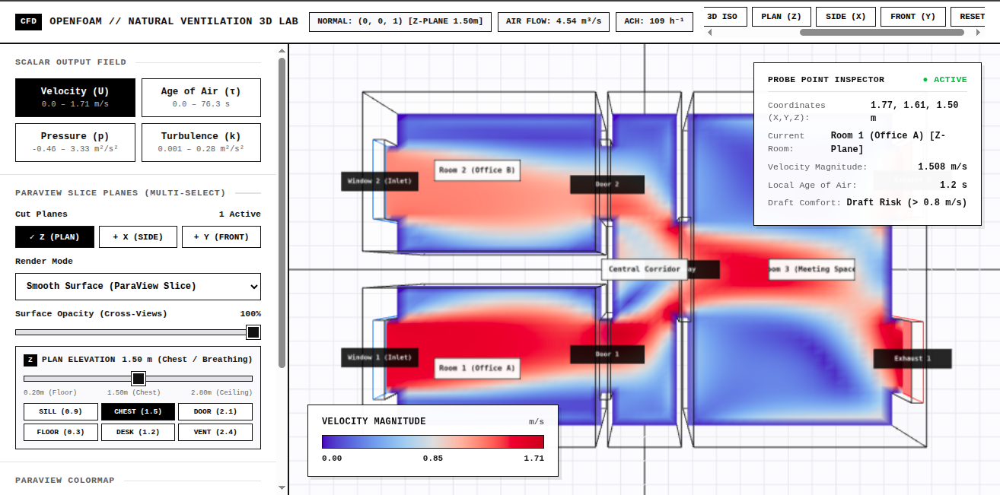
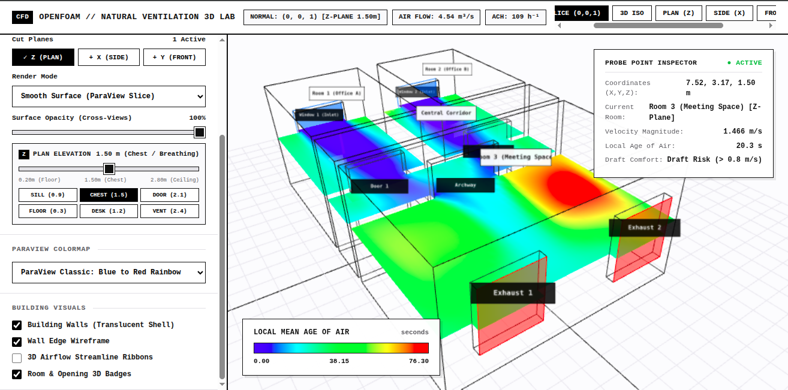

# Room Airflow CFD & Digital Twin

A physics-based digital twin for simulating, analyzing, and interactively visualizing 3D turbulent indoor airflow and Local Mean Age of Air ($\tau$) in a multi-room facility.

Combines high-fidelity OpenFOAM CFD modeling (Reynolds-Averaged Navier–Stokes with $k$-$\varepsilon$ turbulence closure) with a lightweight 3D WebGL interface for multi-axis orthogonal slicing and real-time spatial probing.

---

## Simulation Results

| Plan Velocity Field & Spatial Probe | Local Mean Age of Air ($\tau$) Distribution |
| :---: | :---: |
|  |  |
| *Horizontal plan cut showing windward jet airflow through Office A and doorway into the central corridor, with real-time point probe telemetry.* | *3D scalar field visualization showing fresh air displacement pathways versus leeward room recirculation and stagnation zones.* |

---

## System Requirements

### CFD Simulation & Post-Processing
* **OpenFOAM**: Version 14 (openfoam.org) or OpenFOAM-dev / v11 / v12 / ESI v2212+
  ```bash
  source /opt/openfoam14/etc/bashrc
  ```
* **Post-Processing / Visualization**: ParaView (v5.10+)
* **Python**: Python 3.8+ (for procedural blockMesh generation: `numpy`)

### 3D Digital Twin Viewer
* Modern web browser with WebGL support (Chrome, Firefox, Safari, Edge).
* Zero external dependencies (offline Three.js bundle included).

---

## Project Structure

```
room-airflow-cfd/
├── model/                     # Complete OpenFOAM CFD Simulation Case
│   ├── 0/                     # Initial boundary conditions (U, p, age, k, epsilon, nut)
│   ├── 2000/                  # Converged solution fields (residuals < 1e-4)
│   ├── constant/              # Physical properties, k-epsilon closure & polyMesh
│   ├── system/                # Solvers, schemes, blockMeshDict, multiAxisPlanes (100 cut planes)
│   ├── VTK/                   # Generated volumetric VTK files for ParaView
│   ├── postProcessing/        # Extracted 100 cut planes and probe histories
│   ├── generate_mesh.py       # Procedural blockMesh topology script
│   ├── Allrun                 # Case execution pipeline (mesh -> solve -> age -> VTK)
│   ├── Allclean               # Case cleanup and reset script
│   ├── multiRoomBuilding.foam # Direct ParaView project file
│   └── README.md              # Technical CFD documentation & boundary conditions
├── frontend/                  # Lightweight 3D Digital Twin Viewer
│   ├── index.html             # Interactive 3D WebGL cut-plane viewer
│   ├── data.js                # Pre-compiled 100-plane OpenFOAM dataset (~16 MB)
│   ├── lib/                   # Local offline Three.js and OrbitControls
│   ├── process_slices.py      # OpenFOAM VTK to data.js extraction pipeline
│   └── README.md              # Viewer instructions
├── screenshots/               # High-resolution simulation renders
│   ├── cfd_tri_slice_velocity.png
│   └── cfd_age_of_air.png
├── .gitignore                 # Standard rules
└── README.md                  # This document
```

---

## Physics & Numerical Setup

* **Geometry**: $9.60\,\text{m} \times 6.20\,\text{m} \times 3.00\,\text{m}$ (Volume: $149.8\,\text{m}^3$) multi-room facility with $0.20\,\text{m}$ solid wall thickness across all exterior envelopes and interior partitions.
* **Mesh**: 35,424 structured hexahedral cells generated parametrically with `generate_mesh.py` (non-orthogonality $< 0.1^\circ$, aspect ratio $< 2.8$).
* **Fluid Flow**: Steady-state incompressible Navier–Stokes solved using the SIMPLE algorithm (`foamRun` / `simpleFoam`).
* **Turbulence Closure**: Standard $k$-$\varepsilon$ model with logarithmic wall functions (`nutkWallFunction`, `kqRwallFunction`, `epsilonWallFunction`).
* **Boundary Conditions**:
  * **Windward Inlets**: Window 1: $\mathbf{U} = (1.5, 0.1, 0)\,\text{m/s}$ ($+3.8^\circ$ oblique); Window 2: $\mathbf{U} = (1.2, -0.1, 0)\,\text{m/s}$ ($-4.8^\circ$ oblique).
  * **Leeward Outlets**: Zero-gauge atmospheric pressure ($p = 0\,\text{m}^2/\text{s}^2$) with `inletOutlet` boundary condition.
  * **Flow Rate**: $Q = 4.54\,\text{m}^3/\text{s}$ ($16,330\,\text{m}^3/\text{h}$), delivering a natural ventilation rate of **$109\,\text{ACH}$**.
* **Local Mean Age of Air ($\tau$)**: Solved via passive scalar advection-diffusion equation with source term $S = 1$:
  $$\nabla \cdot (\mathbf{U} \tau) - \nabla \cdot \left[ \left( D_m + \frac{\nu_t}{Sc_t} \right) \nabla \tau \right] = 1$$
  Identifies air residence times ranging from $< 8\,\text{s}$ in high-velocity doorway jets up to $\approx 76.3\,\text{s}$ in leeward corner recirculation zones.

---

## Quickstart

### 1. View the 3D Digital Twin
Open the viewer in any browser:
```bash
# Option A: Direct file open
xdg-open frontend/index.html   # Linux
open frontend/index.html       # macOS

# Option B: Local HTTP server
cd frontend
python3 -m http.server 8080
# Navigate to http://localhost:8080
```

### 2. Inspect the CFD Model in ParaView
The `model/` folder contains the complete simulation output including volumetric VTK files:
```bash
paraview model/multiRoomBuilding.foam
# or open model/VTK/multiRoomBuilding_2000.vtk
```

### 3. Re-run OpenFOAM Simulation from Scratch
To re-run the complete CFD case:
```bash
cd model
source /opt/openfoam14/etc/bashrc   # Or your OpenFOAM installation path
./Allrun
```

---

## License & Credits
* **Project**: MIT License (see [LICENSE](LICENSE)).
* **Simulation Engine**: [OpenFOAM](https://openfoam.org/) is released under the GNU General Public License (GPLv3).
* **3D Visualization**: Built with [Three.js](https://threejs.org/) (MIT License, © Three.js Authors).
